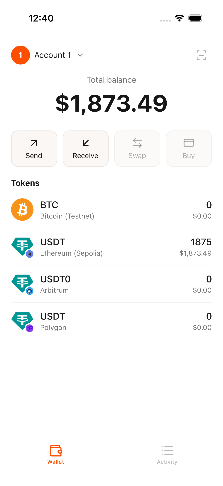
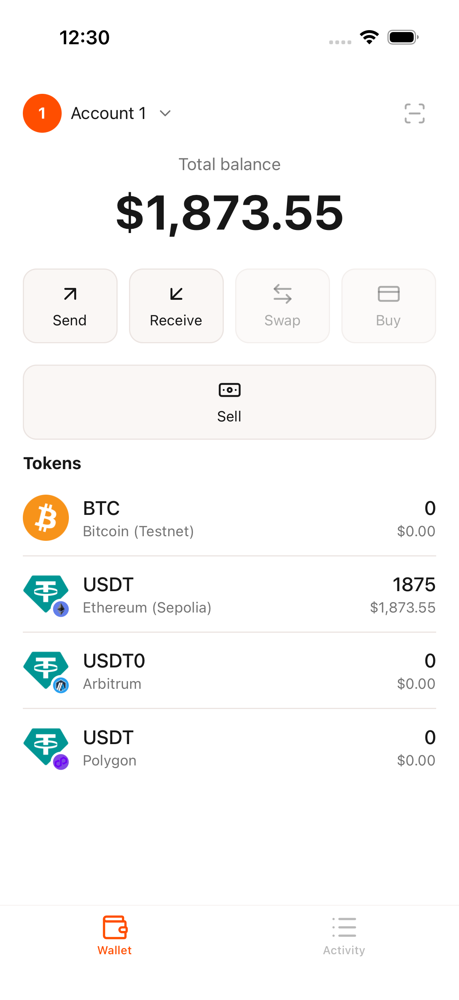
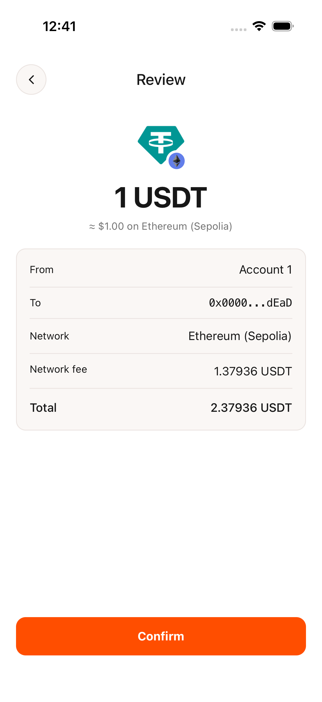
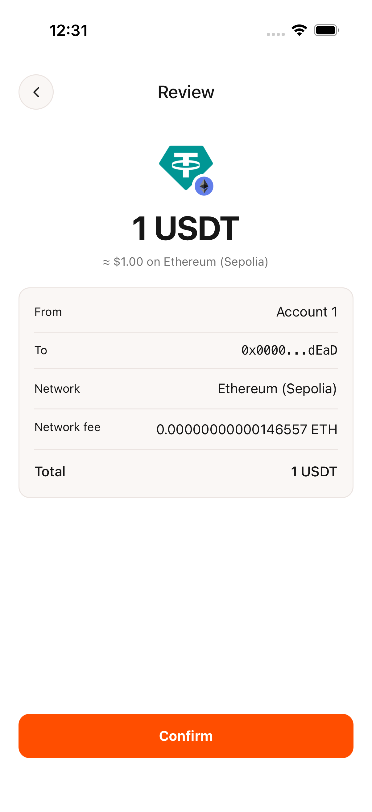
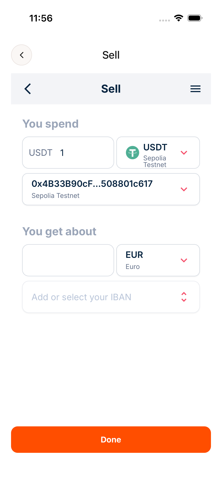
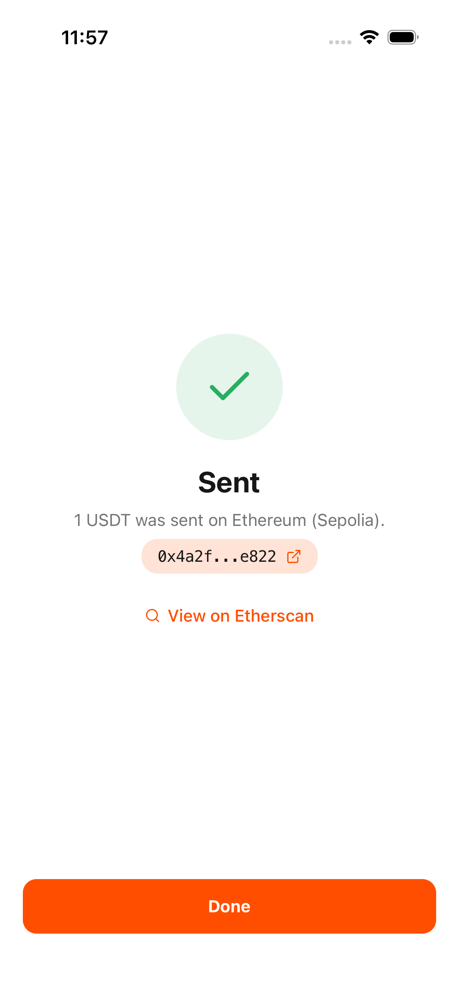

<!-- generated by scripts/handbook/build.mjs; do not edit -->
# Handbook

Screens shown by this module in the WDK starter wallet at commit `031e210e8d7ef322a9c3100f5aed3f4b7c6e34e6`.

## Wallet

| Before | After |
| --- | --- |
|  |  |

The wallet tab shows balances and actions. The added Sell button opens the sell page; Send opens the send flow.

## Send review

| Before | After |
| --- | --- |
|  |  |

The review shows a 1 USDT send on Ethereum (Sepolia), its recipient, network fee and total. Previously the fee was shown in USDT and included in the total; the updated review shows the fee in ETH and excludes it from the USDT total. Confirm sends the transaction.

## Sell widget

The Sell page opens the DFX widget with 1 USDT selected. On the bank step, the user can add or select an IBAN; Done returns to the wallet.

## Unchanged screens in the sale flow

### Send success

This screen comes from the starter wallet and appears after sending in the sale flow, showing a shortened transaction hash.

## Not covered (4)

- **Sell — Opening sell:** The loading state is transient and is replaced by the widget.
- **Sell — Error:** A failed sell() call or missing sell URL produces an error; these states cannot be induced in the real run without falsification.
- **Sell widget — IBAN entry and Payment Information:** These steps expose the payout IBAN alongside the deposit address.
- **Send review — Other Ethereum tokens:** The fee display change also applies to other non-native Ethereum tokens; only USDT is captured.

## How the images were made

- **Wallet:** `run-sale.mjs --handbook-shots` on the `before` and `sale` builds of `e2e/wallet-ui/build.sh` at module commit e40665b, on 2026-11-13; nothing was sent.
- **Send review:** `run-sale.mjs --handbook-shots` on the `before` and `sale` builds at module commit e40665b, on 2026-11-13, with recipient 0x000000000000000000000000000000000000dEaD; the flow stops at the review and nothing was sent.
- **Sell widget:** `run-sale.mjs --send --confirm --screenshots` during the real sale of 2026-11-13 at module commit 320d669 (Sepolia transaction 0x4a2f…e822), on the bank step before an IBAN was entered.
- **Send success:** `run-sale.mjs --send --confirm --screenshots` during the same real sale, after the one tap on Confirm.

Each image passed the [redaction check](redaction.json). The coverage test checks each image against its current redaction record; OCR and QR scanning run separately with `npm run handbook:redaction`.
